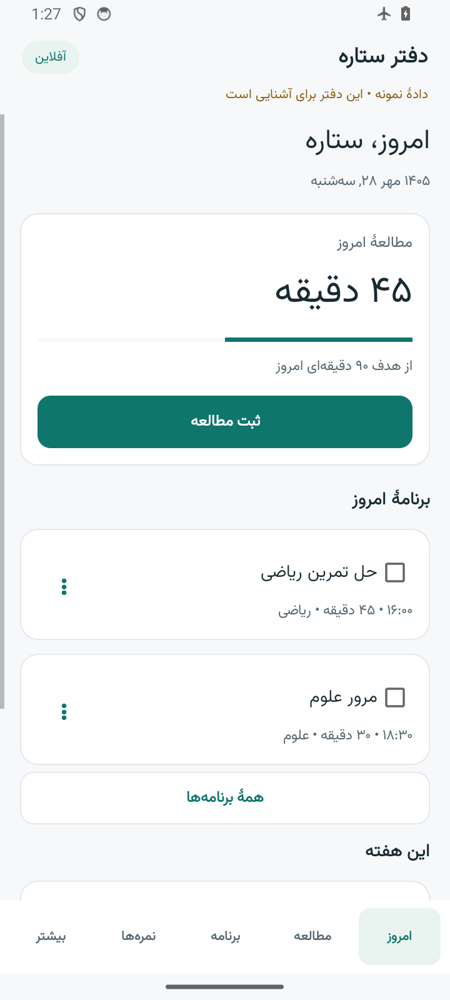
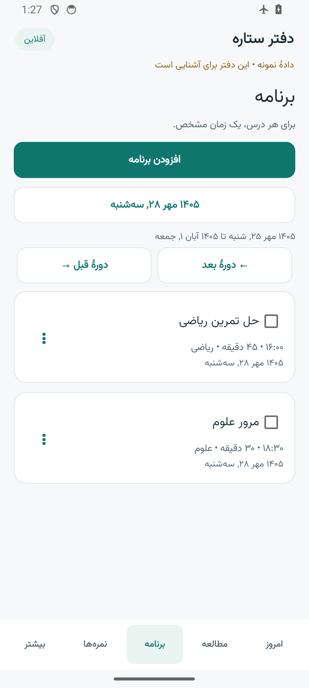
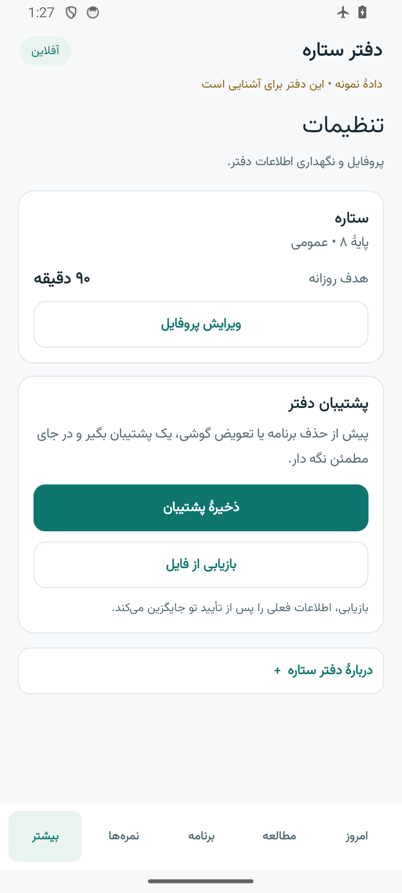

# بررسی نسخهٔ ۱٫۱٫۰ دفتر ستاره

بررسی ۲۰ اکتبر ۲۰۲۶ با دادهٔ ساختگی انجام شد. پیش از تغییر، ۱۰۳ آزمون واحد و ۱۴ آزمون مرورگر نسخهٔ سروری اجرا شدند و از سورس و پایگاه دادهٔ موجود پشتیبان گرفته شد. این گزارش محدودهٔ آزموده‌شده را بیان می‌کند و تضمین نبودن تمام باگ‌های ممکن نیست.

## تغییرات رابط و رفع ایراد

- صفحهٔ امروز یک کار اصلی دارد: ثبت مطالعه. منو کوتاه‌تر و ابزارهای تکمیلی در «بیشتر» قرار گرفته‌اند.
- زمینهٔ روشن، رنگ سبزآبی، متن خواناتر، فرم‌های کوتاه‌تر و جزئیات اختیاری جمع‌شونده روی وب و اندروید اجرا شده‌اند.
- زمان منفی یا اعشاری خطای مشخص می‌دهد؛ اعداد فارسی پذیرفته می‌شوند.
- در اندروید، ویرایش متن کارها وضعیت تیک و ارتباط درس را حفظ می‌کند.
- در وب مستقل، تغییر «۱۸ از ۲۰» به حالت درصدی «۹۰ از ۱۰۰» را حفظ می‌کند؛ نمرهٔ اعلام‌نشده خالی می‌ماند.
- سرریز تنظیمات در موبایل، خروج فوکوس از پنجرهٔ فرم با Tab، و بازشدن راهنما هنگام قطع اینترنت اصلاح شدند.
- پشتیبان دارای شناسهٔ نامعتبر رد می‌شود و هدف‌های اعشاری معتبر نسخهٔ قبلی اندروید همچنان قابل انتقال‌اند.

## وب مستقل و نسخهٔ سروری

[وب مستقل](https://matinmt3.github.io/daftar-setareh/) با دفتر خالی و بدون ثبت‌نام شروع می‌شود. داده‌ها در مرورگر همان دستگاه ذخیره می‌شوند. دریافت کامل اولیه به اینترنت نیاز دارد؛ پس از آن فایل‌های برنامه و راهنما در دسترس آفلاین‌اند. وب و اندروید خودکار همگام نمی‌شوند؛ انتقال پشتیبان JSON با انتخاب و تأیید کاربر، اطلاعات مقصد را جایگزین می‌کند.

| بررسی | نتیجه |
| --- | --- |
| lint، آزمون واحد، ساخت تولید و TypeScript | موفق در [GitHub Actions](https://github.com/matinmt3/daftar-setareh/actions/runs/39404047998) |
| آزمون واحد نهایی | ۱۳۰ از ۱۳۰ در ۱۲ فایل؛ اجرای محلی نهایی ۱۷٫۲۱ ثانیه |
| مرورگر مستقل روی ساخت تولید | ۲۶ از ۲۶ در تلاش اول؛ ۲۹٫۱۳ ثانیه؛ بدون شکست، skip یا flaky |
| نمایش وب مستقل | عرض‌های ۳۲۰، ۳۹۰، ۷۶۸ و ۱۴۴۰ پیکسل؛ بررسی سرریز و ثبت تصاویر |
| مرورگر نسخهٔ سروری | ۱۶ آزمون کامل، سپس آزمون‌های مرتبط پس از آخرین اصلاحات؛ ۲۱ ترکیب مسیر/اندازه بدون خطای صفحه یا سرریز افقی |
| پشتیبان وب به اندروید | ۹ بررسی موفق؛ مقایسهٔ تمام فیلدهای نمونه پس از ورود و خروج از Android Store |
| پشتیبان اندروید به وب | مقایسهٔ تمام فیلدهای پروفایل، درس، گزارش، آزمون، جلسه و هدف موفق |

آزمون مرورگر مستقل ثبت و ویرایش اطلاعات، تقویم شمسی، نمره و ضریب، بایگانی، کارنامه، چاپ، پشتیبان و بازیابی، حافظهٔ پر/خراب، تعارض قابل تشخیص دو تب، استفادهٔ آفلاین و مسیرهای راهنما را پوشش می‌دهد. گزارش JSON و HTML به‌عنوان artifact اجرای CI نگهداری می‌شوند. انتشار Pages فقط پس از موفقیت سه کار وب سروری، اندروید و وب مستقل انجام می‌شود.

نسخهٔ Next.js/SQLite در سورس موجود است و برای اجرا به سرور نیاز دارد؛ Pages از کد مستقل پوشهٔ web-offline استفاده می‌کند. پیامک واقعی و زیرساخت زمان‌بند نسخهٔ سروری آزموده نشده‌اند.

## اندروید

| بررسی | نتیجه |
| --- | --- |
| بسته / نسخه | ir.daftarsetareh.offline / 1.1.0، versionCode 2 |
| آزمون واحد | ۲۳ از ۲۳ |
| گردش بومی Android 14 / API 34 | ۸۱ بررسی موفق در بستهٔ جداگانهٔ QA؛ حالت پرواز، Wi-Fi و داده خاموش |
| ماندگاری پس از بستن کامل و اجرای مجدد | ۱۵ بررسی موفق |
| اجرای APK امضاشدهٔ نهایی | ۱۳ بررسی موفق؛ ساخت دفتر محلی، ۹ مسیر و زنده‌ماندن پردازش بدون FATAL |
| lint و ساخت release | موفق؛ صفر خطا و دو هشدار سازگاری API در کد محافظت‌شده |
| مجوزهای Manifest | بدون مجوز، از جمله بدون INTERNET |
| حداقل / target SDK | API 26 / API 36 |
| امضا | RSA 3072، APK Signature Scheme v2؛ همان گواهی نسخهٔ ۱٫۰٫۰ |

schema و فایل‌های Core، Dates و Store نسبت به ۱٫۰٫۰ تغییر نکرده‌اند. شناسه و کلید امضا حفظ شده‌اند؛ APK جدید برای به‌روزرسانی نصب قبلی است. پیش از هر تغییر پشتیبان بگیرید؛ حذف نصب، دفتر محلی را پاک می‌کند.

گوشی فیزیکی، اجرای API 26 و API 36، تمام ارائه‌دهندگان انتخاب فایل و چاپگر فیزیکی آزموده نشده‌اند. آزمون‌های کامل اجرایی روی بستهٔ QA انجام شدند؛ APK release جداگانه نصب و آزمون اولیه شد. یکسان‌بودن بایت‌های debug و release ادعا نمی‌شود.

SHA-256 فایل APK نهایی:
    f97893c5fd6dcca96b0f5ab849576c254c684ce82575d8a1dfb78a34c7ae1b2b

SHA-256 گواهی عمومی امضا:
    fb51581c3d5937080eae67274138eb2559c034c0ba97f14517a4ba6649d317f6

## SEO، کشف محتوا و محدودیت‌ها

چهار صفحهٔ دفتر، راهنما، درباره و حریم خصوصی HTML فارسی، عنوان، توضیح، canonical و پیوندهای مشخص دارند. دادهٔ ساختاریافته، تصویر اشتراک‌گذاری، sitemap و llms.txt با اطلاعات واقعی نسخهٔ مستقل ساخته می‌شوند.

اندازه‌گیری تازهٔ Lighthouse روی آدرس منتشرشده، گزارش HTTP و SHA-256 همراه [انتشار ۱٫۱٫۰](https://github.com/matinmt3/daftar-setareh/releases/tag/v1.1.0) ارائه می‌شوند. نتایج قبلی نسخهٔ سروری به سایت تازه تعمیم داده نمی‌شوند. GEO امتیاز رسمی و عمومی واحدی ندارد؛ آماده‌بودن محتوا تضمین نمایه‌شدن، رتبه یا ارجاع موتورهای هوش مصنوعی نیست.

وب و اندروید مستقل‌اند و ورود پیامکی، همگام‌سازی ابری یا اعلان پس‌زمینه ندارند. دادهٔ محلی و JSON پشتیبان رمزگذاری نشده‌اند. حفاظت دو تب، تغییرات قابل تشخیص پیش از ذخیره را متوقف می‌کند؛ تراکنش اتمی بین پردازش‌های مرورگر ادعا نمی‌شود. داده‌های موجود کاربر و تنظیمات خصوصی حفظ شده‌اند؛ پایگاه داده، رمز و کلید امضا در سورس عمومی منتشر نشده‌اند.

[راهنمای اندروید](../android/README-fa.md) · [راهنمای وب](https://matinmt3.github.io/daftar-setareh/guide/)

